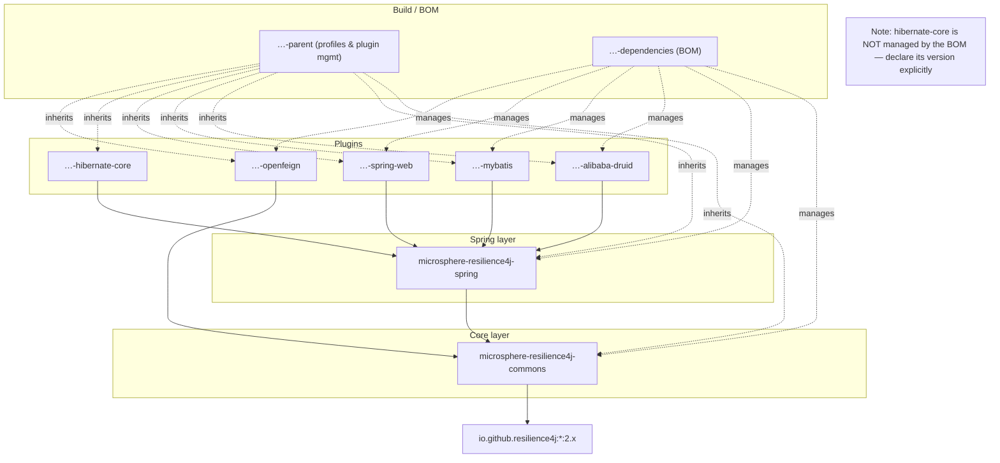

# User Guide — Current (release branch, v0.2.x)

> Source branch: `release` · Version line: `0.2.x` (latest release `0.2.4`) · Target: **Resilience4j 2.0.0 – 2.4.0**
> 中文版本见 [zh/README.md](zh/README.md)

## What is microsphere-resilience4j?

**microsphere-resilience4j** provides a lightweight, unified programming layer on top of [Resilience4j](https://resilience4j.readme.io/). Instead of learning six separate Resilience4j APIs (CircuitBreaker, RateLimiter, Retry, Bulkhead, ThreadPoolBulkhead, TimeLimiter), you program against one consistent set of templates, a single `Resilience4jFacade`, and — in Spring applications — a family of `@Enable*` annotations with a Spring event bridge for Resilience4j events.

Key properties:

- **Framework-neutral core** — `microsphere-resilience4j-commons` has no Spring dependency; every module ships a Template class implementing the common `Resilience4jOperations` contract.
- **Uniform API surface** — the same `execute / run / supply / withinContext / withCallback...` shape across all six resilience modules.
- **Chainable composition** — `ChainableResilience4jFacade` composes multiple modules (e.g. Retry → CircuitBreaker → RateLimiter) around one call.
- **Spring integration** — `@EnableResilience4j` and per-module `@Enable*` annotations register decorators, and Resilience4j events are re-published as Spring `ApplicationEvent`s.
- **Framework plugins** — drop-in resilience for Druid, MyBatis, OpenFeign, Spring Web, and Hibernate.

## Version and Compatibility

| Component | Compatible Range | Notes |
|-----------|------------------|-------|
| microsphere-resilience4j | `0.2.x` (`release` branch) | latest release `0.2.4`, next `0.2.5-SNAPSHOT` |
| Resilience4j | 2.0.0, 2.1.0, 2.2.0, 2.3.0, 2.4.0 | selected via Maven profiles `resilience4j-2.0` … `resilience4j-2.4`; **default is 2.4.0** |
| Spring Cloud | 2022.0.x – 2025.0.x | via parent `microsphere-spring-cloud-parent` 0.2.26 |
| JDK | 17+ (CI matrix: JDK 17 / 21 / 25) | see [developer guide](../developer-guide/README.md) build section |

> The `1.x` line (v0.1.x) targets Resilience4j **1.3.0 – 1.7.0** and Spring Cloud Hoxton – 2021.0.x. Do not mix the two lines: pick the [1.x User Guide](../../1.x/user-guide/README.md) if you are pinned to Resilience4j 1.x.

## Installation

Add the BOM, then depend on the modules you need:

```xml
<dependencyManagement>
    <dependencies>
        <dependency>
            <groupId>io.github.microsphere-projects</groupId>
            <artifactId>microsphere-resilience4j-dependencies</artifactId>
            <version>0.2.4</version>
            <type>pom</type>
            <scope>import</scope>
        </dependency>
    </dependencies>
</dependencyManagement>

<dependencies>
    <!-- framework-neutral core -->
    <dependency>
        <groupId>io.github.microsphere-projects</groupId>
        <artifactId>microsphere-resilience4j-commons</artifactId>
    </dependency>
    <!-- optional: Spring annotation & event integration -->
    <dependency>
        <groupId>io.github.microsphere-projects</groupId>
        <artifactId>microsphere-resilience4j-spring</artifactId>
    </dependency>
</dependencies>
```

## Module Dependency Map



Choose your entry point:

- No Spring in your project (or you want plain Java control) → **commons** templates + facade.
- Spring application → add **spring** for annotations and Spring-event exposure of Resilience4j events.
- Specific framework traffic (SQL pool, ORM, HTTP client/server) → add the matching **plugin**.

## User Guide Pages

Each page covers the public API, code examples (from the project test-cases), configuration, and version notes for one Maven module. Chinese twins live in `zh/` with identical file names.

| Page | Module | When to read |
|------|--------|--------------|
| [microsphere-resilience4j-commons.md](microsphere-resilience4j-commons.md) | commons | All six templates, `Resilience4jOperations`, `Resilience4jFacade`, `ChainableResilience4jFacade`, `CallbackChain`, `Resilience4jContext` |
| [microsphere-resilience4j-spring.md](microsphere-resilience4j-spring.md) | spring | `@EnableResilience4j` and per-module `@Enable*` annotations, event consumers, `Resilience4jPlugin` SPI |
| [microsphere-resilience4j-alibaba-druid.md](microsphere-resilience4j-alibaba-druid.md) | plugin | Resilience for Druid-filtered SQL execution |
| [microsphere-resilience4j-mybatis.md](microsphere-resilience4j-mybatis.md) | plugin | Resilience for MyBatis `Executor` operations |
| [microsphere-resilience4j-openfeign.md](microsphere-resilience4j-openfeign.md) | plugin | Feign `Capability`/`Client`/`InvocationHandler` decoration |
| [microsphere-resilience4j-spring-web.md](microsphere-resilience4j-spring-web.md) | plugin | Resilience for Spring MVC handler methods |
| [microsphere-resilience4j-hibernate-core.md](microsphere-resilience4j-hibernate-core.md) | plugin | Hibernate entity lifecycle callback protection |
| [microsphere-resilience4j-dependencies.md](microsphere-resilience4j-dependencies.md) | BOM | What the BOM manages, how to override versions |
| [microsphere-resilience4j-parent.md](microsphere-resilience4j-parent.md) | parent | Version profiles, `resilience4j-2.x` selection |
| [microsphere-resilience4j-spring-boot.md](microsphere-resilience4j-spring-boot.md) | spring-boot | Status of the placeholder module |
| [microsphere-resilience4j-spring-cloud.md](microsphere-resilience4j-spring-cloud.md) | spring-cloud | Status of the placeholder module |

## Quick Start (30 seconds)

```java
import io.github.resilience4j.bulkhead.BulkheadRegistry;
import io.github.resilience4j.circuitbreaker.CircuitBreakerRegistry;
import io.microsphere.resilience4j.bulkhead.BulkheadTemplate;
import io.microsphere.resilience4j.circuitbreaker.CircuitBreakerTemplate;
import io.microsphere.resilience4j.common.ChainableResilience4jFacade;

CircuitBreakerTemplate circuitBreakerTemplate =
        new CircuitBreakerTemplate(CircuitBreakerRegistry.ofDefaults());
BulkheadTemplate bulkheadTemplate =
        new BulkheadTemplate(BulkheadRegistry.ofDefaults());

ChainableResilience4jFacade facade = new ChainableResilience4jFacade(
        java.util.Arrays.asList(circuitBreakerTemplate, bulkheadTemplate));

String result = facade.execute("backend-service", () -> callRemoteService());
```

Full walkthroughs per module are on the pages above.
