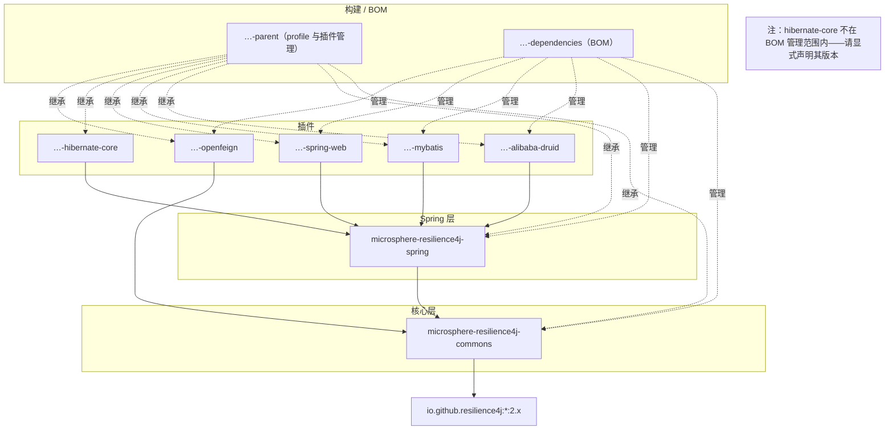

# 用户指南 —— 当前（release 分支，v0.2.x）

> 源分支：`release` · 版本线：`0.2.x`（最新发版 `0.2.4`） · 目标：**Resilience4j 2.0.0 – 2.4.0**
> English 版本见 [../README.md](../README.md)

## microsphere-resilience4j 是什么？

**microsphere-resilience4j** 在 [Resilience4j](https://resilience4j.readme.io/) 之上提供了一个轻量、统一的编程层。你无需分别学习六套 Resilience4j API（CircuitBreaker、RateLimiter、Retry、Bulkhead、ThreadPoolBulkhead、TimeLimiter），而是面向一组风格一致的模板、单个 `Resilience4jFacade` 进行编程；在 Spring 应用中，还有一系列 `@Enable*` 注解，以及把 Resilience4j 事件转发的 Spring 事件桥。

关键特性：

- **框架中立的核心** — `microsphere-resilience4j-commons` 不依赖 Spring；每个模块都提供一个实现通用 `Resilience4jOperations` 契约的模板类。
- **统一的 API 表面** — 六个弹性模块都采用相同的 `execute / run / supply / withinContext / withCallback...` 形态。
- **可链式组合** — `ChainableResilience4jFacade` 可在单次调用外层组合多个模块（例如 Retry → CircuitBreaker → RateLimiter）。
- **Spring 集成** — `@EnableResilience4j` 及各模块的 `@Enable*` 注解用于注册装饰器，Resilience4j 事件会被重新发布为 Spring 的 `ApplicationEvent`。
- **框架插件** — 为 Druid、MyBatis、OpenFeign、Spring Web 和 Hibernate 提供即插即用的弹性能力。

## 版本与兼容性

| 组件 | 兼容范围 | 说明 |
|-----------|------------------|-------|
| microsphere-resilience4j | `0.2.x`（`release` 分支） | 最新发版 `0.2.4`，下一个 `0.2.5-SNAPSHOT` |
| Resilience4j | 2.0.0、2.1.0、2.2.0、2.3.0、2.4.0 | 通过 Maven profile `resilience4j-2.0` … `resilience4j-2.4` 选择；**默认为 2.4.0** |
| Spring Cloud | 2022.0.x – 2025.0.x | 经由父工程 `microsphere-spring-cloud-parent` 0.2.26 |
| JDK | 17+（CI 矩阵：JDK 17 / 21 / 25） | 参见[开发者指南](../../developer-guide/zh/README.md)的构建章节 |

> `1.x` 版本线（v0.1.x）面向 Resilience4j **1.3.0 – 1.7.0** 与 Spring Cloud Hoxton – 2021.0.x。请勿混用两条版本线：若你被固定在 Resilience4j 1.x，请选用 [1.x 用户指南](../../../1.x/user-guide/zh/README.md)。

## 安装

先添加 BOM，再依赖你需要的模块：

```xml
<dependencyManagement>
    <dependencies>
        <dependency>
            <groupId>io.github.microsphere-projects</groupId>
            <artifactId>microsphere-resilience4j-dependencies</artifactId>
            <version>0.2.4</version>
            <type>pom</type>
            <scope>import</scope>
        </dependency>
    </dependencies>
</dependencyManagement>

<dependencies>
    <!-- 框架中立的核心 -->
    <dependency>
        <groupId>io.github.microsphere-projects</groupId>
        <artifactId>microsphere-resilience4j-commons</artifactId>
    </dependency>
    <!-- 可选：Spring 注解与事件集成 -->
    <dependency>
        <groupId>io.github.microsphere-projects</groupId>
        <artifactId>microsphere-resilience4j-spring</artifactId>
    </dependency>
</dependencies>
```

## 模块依赖图



选择你的入口：

- 项目中没有 Spring（或你想要纯 Java 控制）→ **commons** 模板 + 门面。
- Spring 应用 → 添加 **spring**，以获得注解支持以及把 Resilience4j 事件以 Spring 事件形式对外暴露。
- 针对特定框架流量（SQL 连接池、ORM、HTTP 客户端/服务端）→ 添加对应的**插件**。

## 用户指南页面

每个页面覆盖某个 Maven 模块的公开 API、代码示例（源自项目的测试用例）、配置以及版本说明。中文版页面存放于 `zh/`，文件名完全一致。

| 页面 | 模块 | 何时阅读 |
|------|--------|--------------|
| [microsphere-resilience4j-commons.md](microsphere-resilience4j-commons.md) | commons | 全部六个模板、`Resilience4jOperations`、`Resilience4jFacade`、`ChainableResilience4jFacade`、`CallbackChain`、`Resilience4jContext` |
| [microsphere-resilience4j-spring.md](microsphere-resilience4j-spring.md) | spring | `@EnableResilience4j` 及各模块的 `@Enable*` 注解、事件消费者、`Resilience4jPlugin` SPI |
| [microsphere-resilience4j-alibaba-druid.md](microsphere-resilience4j-alibaba-druid.md) | 插件 | 为经 Druid 过滤器拦截的 SQL 执行提供弹性 |
| [microsphere-resilience4j-mybatis.md](microsphere-resilience4j-mybatis.md) | 插件 | 为 MyBatis `Executor` 操作提供弹性 |
| [microsphere-resilience4j-openfeign.md](microsphere-resilience4j-openfeign.md) | 插件 | Feign `Capability`/`Client`/`InvocationHandler` 装饰 |
| [microsphere-resilience4j-spring-web.md](microsphere-resilience4j-spring-web.md) | 插件 | 为 Spring MVC 处理方法提供弹性 |
| [microsphere-resilience4j-hibernate-core.md](microsphere-resilience4j-hibernate-core.md) | 插件 | Hibernate 实体生命周期回调保护 |
| [microsphere-resilience4j-dependencies.md](microsphere-resilience4j-dependencies.md) | BOM | BOM 管理哪些内容、如何覆盖版本 |
| [microsphere-resilience4j-parent.md](microsphere-resilience4j-parent.md) | 父工程 | 版本 profile、`resilience4j-2.x` 选择 |
| [microsphere-resilience4j-spring-boot.md](microsphere-resilience4j-spring-boot.md) | spring-boot | 占位模块的状态 |
| [microsphere-resilience4j-spring-cloud.md](microsphere-resilience4j-spring-cloud.md) | spring-cloud | 占位模块的状态 |

## 快速上手（30 秒）

```java
import io.github.resilience4j.bulkhead.BulkheadRegistry;
import io.github.resilience4j.circuitbreaker.CircuitBreakerRegistry;
import io.microsphere.resilience4j.bulkhead.BulkheadTemplate;
import io.microsphere.resilience4j.circuitbreaker.CircuitBreakerTemplate;
import io.microsphere.resilience4j.common.ChainableResilience4jFacade;

CircuitBreakerTemplate circuitBreakerTemplate =
        new CircuitBreakerTemplate(CircuitBreakerRegistry.ofDefaults());
BulkheadTemplate bulkheadTemplate =
        new BulkheadTemplate(BulkheadRegistry.ofDefaults());

ChainableResilience4jFacade facade = new ChainableResilience4jFacade(
        java.util.Arrays.asList(circuitBreakerTemplate, bulkheadTemplate));

String result = facade.execute("backend-service", () -> callRemoteService());
```

各模块的完整讲解见上方页面。
